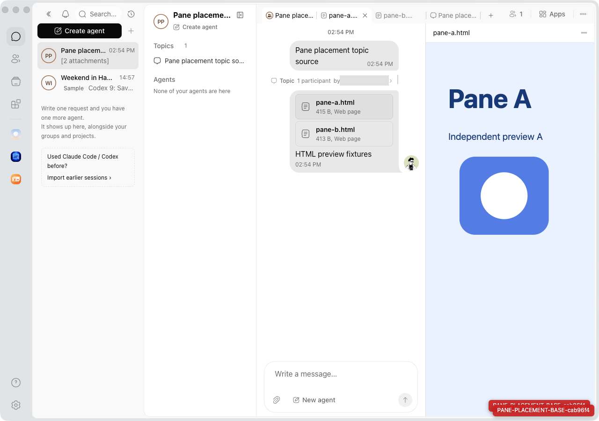
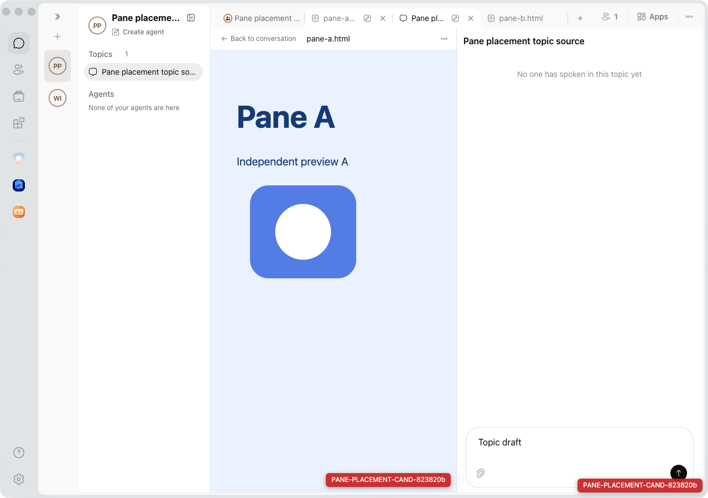
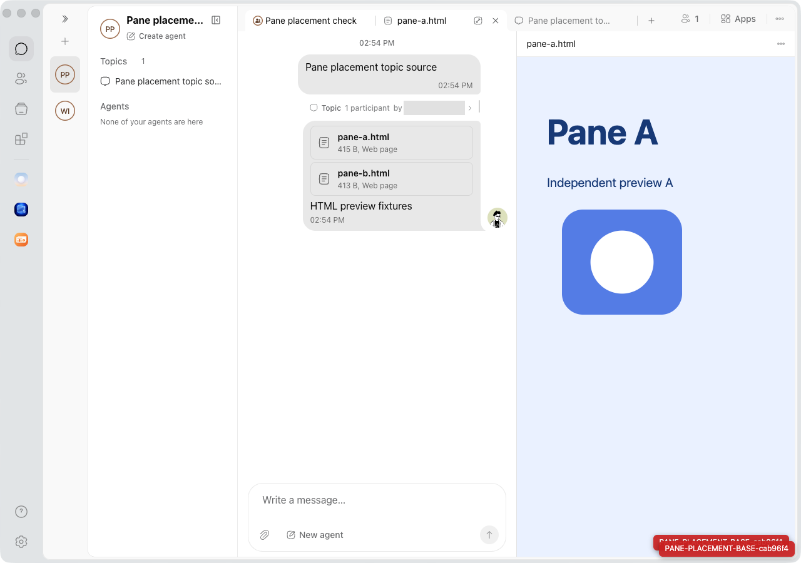
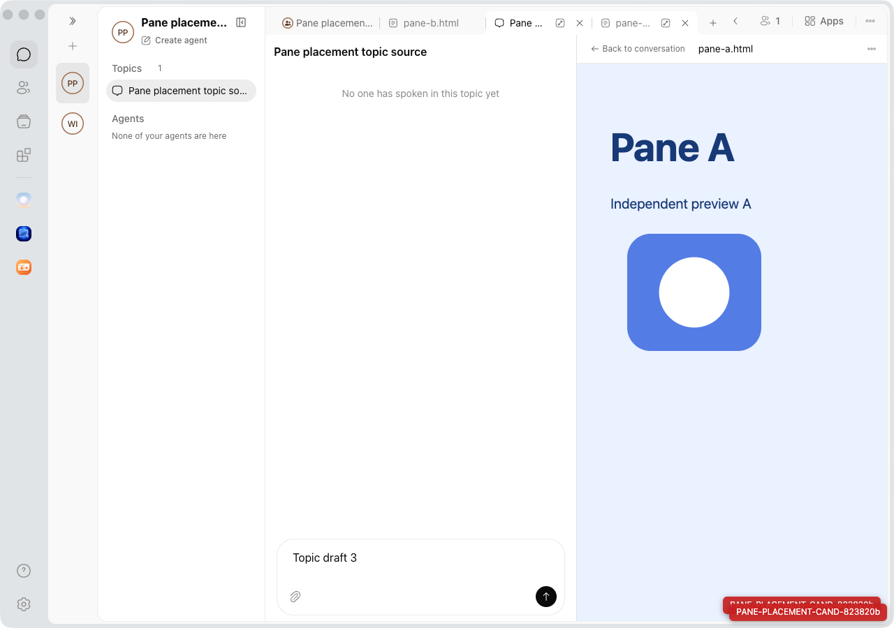
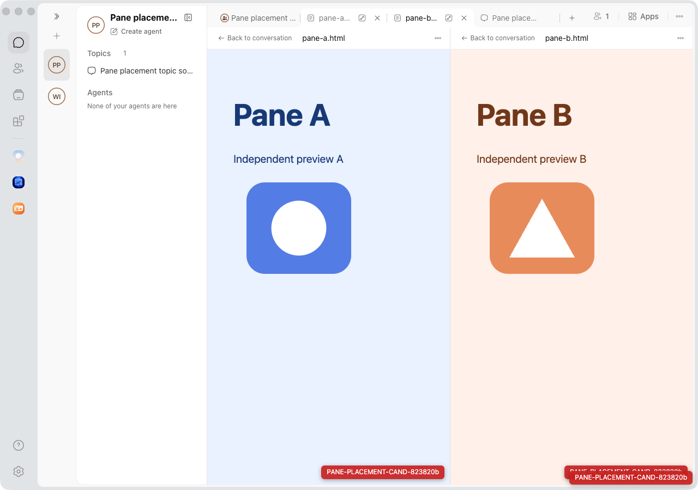

# Pane placement desktop verification

Compared parent `cab96f4b5fd7abc3b6bb7b478f58ef3633295523` with product candidate `823820b302fc1fcc9b66ed354c270a34138490c3` in real desktop clients against the same test backend and account. Later commits only adjust a test host and add this evidence.

Desktop captures retain their original 1280 × 900 pixels. The narrow-window capture is 820 × 900. The navigation sidebar is expanded in the first parent capture and collapsed in its candidate capture; pane widths therefore differ. Focus was checked directly with `document.activeElement`, and pane ownership with `activePaneId`.

The before images have the test account name covered with a solid block. The task image has local paths covered with solid blocks, including the file-card breadcrumbs. All other pixels and image dimensions are unchanged. No generated imagery is used.

## Before and after

| Action | Parent | Candidate |
| --- | --- | --- |
| Type in the topic, then open HTML from the group | HTML replaces the topic; focus leaves its composer. | HTML replaces the group; the topic, its draft, current pane and composer focus remain. |
| Reopen the HTML, then select a hidden file tab | The topic is already gone after the first open. | Reopening retains topic focus; selecting the hidden file replaces the HTML pane. |
| Drop the topic tab on the other pane's center | Main-center drop does not replace the target as requested. | The two visible pages swap. |
| Drop another HTML tab on the HTML pane's edge | The group stays paired with one preview. | The two HTML previews appear beside each other. |

Opening from the group (test account name redacted in the before image):

| Before | After |
| --- | --- |
|  |  |

Center drop (test account name redacted in the before image):

| Before | After |
| --- | --- |
|  |  |

Edge drop (test account name redacted in the before image):

| Before | After |
| --- | --- |
|  |  |

## Additional candidate checks

- [Reopening HTML](after/reopen-file.png) retains the topic's draft and composer focus.
- [Independent zoom](after/independent-zoom.png): right preview 144%, left preview remains 100%. Existing per-preview zoom behavior is unchanged.
- [Narrow window](after/narrow-open.png): opening reveals the destination pane and makes it current; the group remains in the other pane.
- [Task output](after/task-output.png), with local paths redacted: two real turns using Gugu GLM 5.3 Flash. Background file output and reopening a file use the file pane while the task pane, draft and composer focus remain. This task check was run on the candidate only. No gateway errors occurred.

The layout still supports at most two panes and one topic slot per group. Choosing a different topic navigates that slot in place. Supporting two topics beside each other remains a separate product decision.
